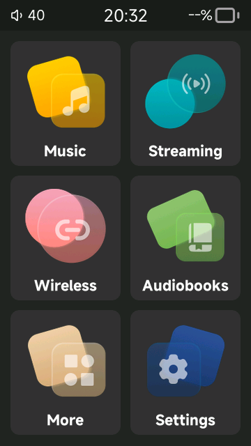
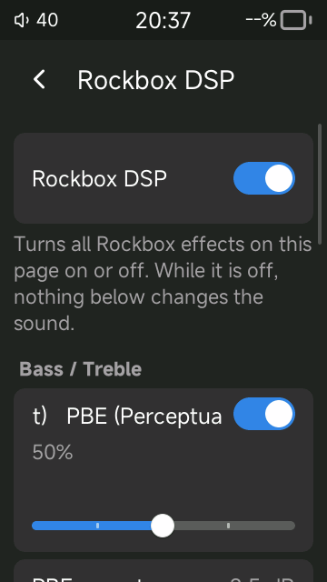
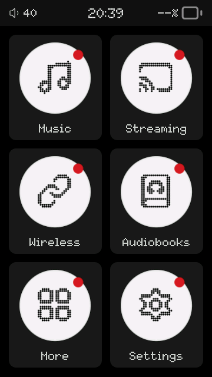
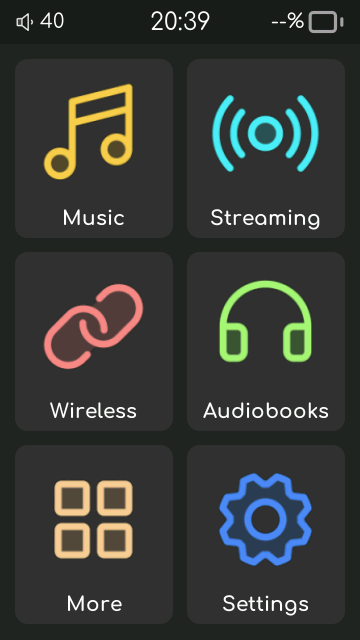

# Sonix Player for the Hidizs AP80 Pro Max

Run [Sonix Player](https://github.com/Tartarus6/sonix-player), a modern music
player, on the **Hidizs AP80 Pro Max**, as a third choice next to the original
HiBy OS and [Rockbox](https://www.rockbox.org). When you switch the player on, a
small menu lets you pick which one starts.

**Only for the AP80 Pro Max.** Not for the AP80, AP80 Pro or AP80 Pro-X.

> [!CAUTION]
> **Use at your own risk.** This is a hobby project. It has **not been thoroughly
> tested**, and only on one player. Installing it, and above all flashing the boot
> menu, can damage your player or leave it unable to start. The author gives
> **no warranty** and is **not responsible for any damage** to your device, your
> data or anything else. If you are not comfortable with that, do not install it.

| Home | Rockbox DSP | PEQdB target | YouTube Music |
|:---:|:---:|:---:|:---:|
|  |  |  |  |

| Nothing skin | Nothing Light skin | Icon packs and fonts | Appearance |
|:---:|:---:|:---:|:---:|
|  |  |  |  |

Screenshots come from the PC simulator at the AP80's resolution (360x640).

## Install

You need the player, its microSD card, a card reader and a computer. Download the
files from the latest [release](https://github.com/Fos4ity/sonix-ap80/releases).

**1. Put Sonix on the card.** Unzip `sonix-ap80-sdcard.zip` to the **root of the
SD card**. Then check: `sonix.sh` and the `sonix` folder must sit directly on the
card (for example `E:\sonix.sh`). Windows' *Extract All* and macOS first put
everything into a folder called `sonix-ap80-sdcard`; if that happened, move its
contents up to the card root. Your music and other files are not touched.

**2. Start it.** Which way depends on what your player shows when you switch it on:

| Your player starts with | Do this | Flashing? |
|---|---|---|
| a menu with ROCKBOX / TOOLS / HIBY PLAYER (you installed Rockbox) | In the menu choose **TOOLS > Run script > sonix.sh**. Done. Optionally do the next row too, to get a SONIX entry. | No |
| straight into HiBy OS (no menu) | Flash the boot menu, below. | Yes, once |

**Flashing the boot menu.** Charge the player. Keep a copy of your original
firmware file. Copy `ap80max-v12-sonix-patched.upt` to the root of the card and
**rename it to `ap80max.upt`**. In HiBy OS go to *System Settings > Firmware
Update > via SD Card > Update System Firmware > OK* and wait until it restarts.
The menu now shows SONIX. Rename or delete `ap80max.upt` on the card afterwards.

The file contains **HiBy firmware 1.2** plus the boot menu: whatever version your
player has now is replaced by 1.2. Your music and the card are not touched.

## Using it

Every time you switch the player on you get **10 seconds** to choose, then your
last choice starts again. The menu only offers what is really on the card:

| Menu entry | Shown when the card has | |
|---|---|---|
| HIBY PLAYER | always | the original firmware |
| TOOLS | always | Rockbox's tools: Run script, Recovery, Restart... |
| SONIX | `sonix.sh` | starts `sonix/sonix_player` |
| ROCKBOX | `.rockbox/rockbox.ap80max` from a [Rockbox build](https://www.rockbox.org/wiki/HidizsPort) | |

The `.rockbox` folder in the SD card package holds only a short note, not Rockbox,
so it does not add the ROCKBOX entry. You do **not** need Rockbox to use Sonix.

Sonix keeps its things on the card, in the `sonix` folder: the program, its
settings, sign-ins to streaming services and its log (`sonix_player.log`,
overwritten at every start). It does
not touch HiBy OS's settings. Only Wi-Fi networks are kept by the player's system
itself, so HiBy OS and Sonix share them. Remove the card, or the `sonix` folder,
and the player works as before, with HiBy OS from the menu.

**YouTube Music** works without an account: Wi-Fi is all it needs. What it shows
follows the language you pick in Sonix (English: US). Signing in (likes, your
playlists) needs your own Google OAuth client, see
[ap80/BUILD.md](ap80/BUILD.md#streaming-keys); without one there is no sign-in button.

## If something goes wrong

- **Sonix does not appear in the menu:** `sonix.sh` is not in the root of the card (see step 1).
- **HiBy OS stays on the menu picture:** switch off and on and pick HIBY PLAYER right
  away. The player has little memory and HiBy OS needs a large block of it.
- **The card does not show up on the computer** after you used *ADB start* in TOOLS:
  restart the player.
- **Sonix misbehaves:** right after it happens, leave Sonix and send `sonix/sonix_player.log`
  and `sonix/sonix_log.txt` from the card with your report. Both are overwritten
  at the next start.

### Going back

1. Delete `.rockbox/rb_bl_mode.txt` and `sonix/rb_bl_mode.txt` from the card (the
   last choice of this boot menu). An older menu does not know the SONIX entry: it
   would show TOOLS and wait for a key instead of starting a player.
2. Install the original firmware from [Hidizs](https://www.hidizs.net), or Rockbox's
   patched file, the same way as the boot menu above.
3. Delete `sonix.sh` and the `sonix` folder from the card if you no longer want them.

If the player shows nothing at all: put the original `ap80max.upt` in the root of
the card and switch the player on while holding **Power + Next**; this should start
the firmware update from the card. We have not needed this ourselves, so we cannot
confirm it.

## What you get

Everything Sonix already does is described in [FEATURES.md](FEATURES.md) and in the
original [README](README.sonix.md). On top of that:

- **Hidizs AP80 Pro Max support.** The 360x640 screen, and running from the SD card
  instead of from the firmware.
- **SONIX entry in the boot menu.** Rockbox, Tools, HiBy Player, Sonix.
- **Rockbox DSP.** Rockbox's sound effects inside Sonix: perceptual bass enhancement
  (PBE), bass and treble, auditory fatigue reduction and Haas surround.
  *Music > gear icon > Rockbox DSP.*
- **PEQdB target for AutoEq.** Downloaded headphone corrections can be re-targeted
  from Harman to the [PEQdB](https://peqdb.com/) "Diamond β" curve. *PEQ > gear icon > AutoEQ target.*
- **Skins.** Colour skins in the simple `.theme` format used by
  [Compas player](https://github.com/Starnished66/compas-player), with an
  optional accent colour. 23 are included: Nothing and Nothing Light made for
  this port, and 21 from Compas player (Arctic Glass, Game Boy, Terminal...).
- **Fonts and icon packs.** 13 fonts and 6 icon packs to choose from, with previews.
- **YouTube Music.** Search, albums, artists, playlists and playback, with no
  account: Wi-Fi is all it needs. The catalogue follows the language you pick in
  Sonix (English: US). Signing in (likes, your playlists) needs your own Google
  OAuth client, see [ap80/BUILD.md](ap80/BUILD.md#streaming-keys); without one
  there is no sign-in button.
- **Small fixes for the narrow screen**: scrolling labels, Flappy Bird, the top bar.

## How it works

```
power on
   └── boot menu (Rockbox bootloader + our patch)
         ├── ROCKBOX       Rockbox, from the SD card
         ├── TOOLS         Rockbox's tools screen
         ├── HIBY PLAYER   the original firmware
         └── SONIX         runs sonix.sh from the SD card  ← added by this fork
```

This repository holds **source code, patches and scripts only**, no firmware.
The ready-made files are on the [Releases](https://github.com/Fos4ity/sonix-ap80/releases)
page; you can also build everything yourself.

## Build it yourself

You need a Linux PC (or WSL on Windows) to build. Allow an hour or two the first
time, most of it is the compiler building itself.

**0. Install Rockbox first.** Follow the official
[Rockbox guide for the AP80 Pro Max](https://www.rockbox.org/wiki/HidizsPort). After
this you already have a boot menu with ROCKBOX, TOOLS and HIBY PLAYER.

**1. Build Sonix.**

```
git clone https://github.com/Fos4ity/sonix-ap80.git
cd sonix-ap80/sonix-player
make -j8 target
```

**2. Put it on the SD card.**

```
cd ..
./ap80/make_sdcard.sh
```

Copy the *contents* of `ap80/out/` to the root of the SD card. You get `sonix.sh`
and a `sonix` folder there.

**3. Try it, without flashing anything.** In the boot menu choose
**TOOLS > Run script > sonix.sh**. Sonix starts. If this is enough for you, stop here.

**4. Optional: add SONIX to the boot menu.** This is the only step that writes to the
player's firmware. Read [ap80/BUILD.md](ap80/BUILD.md), it is short:

```
# build the boot menu from Rockbox + our patch   -> bootloader.ap80max
# then put it into YOUR firmware file:
./ap80/make_upt.sh ap80max.upt bootloader.ap80max
```

Put the resulting file on the SD card as `ap80max.upt` and install it in HiBy OS:
*System Settings > Firmware Update > via SD Card*.

Going back is the same as for the ready-made files, see [Going back](#going-back).
Everything here is provided **as is, with no warranty**, as the GPL says.

## What is in this repository

| Where | What |
|---|---|
| `sonix-player/` | Sonix Player source with the AP80 changes (one commit per feature on the `ap80` branch) |
| `ap80/bootloader/` | Patch for the Rockbox boot menu, and a script to try a build without flashing |
| `ap80/make_upt.sh` | Puts the boot menu into a firmware file you supply |
| `ap80/make_sdcard.sh` | Collects everything that goes on the SD card |
| `ap80/sdcard/` | `sonix.sh` and the extra resources: fonts, icon packs, skins |
| `ap80/tools/` | Scripts that generated the Nothing icon tiles and the Doto font variant |
| `ap80/musicbee/` | Optional MusicBee add-on: send tracks to the player over Wi-Fi |
| `ap80/BUILD.md` | Build details |

Want the changes as plain patches against upstream Sonix?
`git format-patch 5d8bb174..ap80 -- sonix-player` gives you one file per feature.

## Credits: what we borrowed and from whom

This fork stands on other people's work. Thank you.

| What | From | Author(s) | Licence |
|---|---|---|---|
| The player itself | [Sonix Player](https://github.com/Tartarus6/sonix-player) | Tartarus6, started by Jepl4r / M4ttia | GPL v3 |
| Boot menu | Rockbox, [`bootloader/hibyos_linux.c`](https://github.com/Rockbox/rockbox/blob/master/bootloader/hibyos_linux.c) | Amaury Pouly, Marcin Bukat, Roman Stolyarov, Solomon Peachy | GPL v2 or later |
| AP80 Pro Max port of Rockbox | [Rockbox HidizsPort](https://www.rockbox.org/wiki/HidizsPort) | the Rockbox team | GPL v2 or later |
| Firmware repacking script | Rockbox, [`tools/r1_patcher/r1_patcher.sh`](https://github.com/Rockbox/rockbox/blob/master/tools/r1_patcher/r1_patcher.sh) | the Rockbox team | GPL v2 or later |
| Bass enhancement (PBE) | Rockbox, [`lib/rbcodec/dsp/pbe.c`](https://github.com/Rockbox/rockbox/blob/master/lib/rbcodec/dsp/pbe.c) | Chiwen Chang | GPL v2 or later |
| Auditory fatigue reduction | Rockbox, [`lib/rbcodec/dsp/afr.c`](https://github.com/Rockbox/rockbox/blob/master/lib/rbcodec/dsp/afr.c) | Chiwen Chang | GPL v2 or later |
| Haas surround | Rockbox, [`lib/rbcodec/dsp/surround.c`](https://github.com/Rockbox/rockbox/blob/master/lib/rbcodec/dsp/surround.c) | Chiwen Chang | GPL v2 or later |
| Bass / treble | Rockbox, [`lib/rbcodec/dsp/tone_controls.c`](https://github.com/Rockbox/rockbox/blob/master/lib/rbcodec/dsp/tone_controls.c) | Thom Johansen, Michael Sevakis | GPL v2 or later |
| Compiler toolchain | Rockbox, `rockboxdev.sh` (already used by Sonix) | the Rockbox team | GPL v2 or later |
| "Diamond β" target curve | [PEQdB](https://peqdb.com/) | sharur (S. Chala, *An Optimized Headphone Target Response Curve*) | curve values only |
| Headphone corrections | [AutoEq](https://github.com/jaakkopasanen/AutoEq) (already used by Sonix) | Jaakko Pasanen | MIT |
| Skin file format and 21 skins | [Compas player](https://github.com/Starnished66/compas-player) | Starnished66 and the Compas contributors | GPL v3 (format and `.theme` files, no code taken; see `themes/CREDITS.txt`) |
| Icons | [Lucide](https://lucide.dev), [Phosphor](https://phosphoricons.com) | their contributors | ISC, MIT |
| Fonts | Inter, Lexend, Nunito, Noto Sans, Source Sans 3, Atkinson Hyperlegible, Comfortaa, JetBrains Mono, Merriweather, Oswald, Quicksand, Space Grotesk, Doto | their designers | SIL OFL 1.1 (licence file next to each font) |

The Rockbox effects were rewritten from fixed point to floating point to fit Sonix's
audio path; the original copyright notices are kept in
[`sonix-player/src/system/audio/pbe.c`](sonix-player/src/system/audio/pbe.c).

Not affiliated with Hidizs, HiBy, Rockbox, Google, Nothing or the Sonix authors.
All product names belong to their owners.

## Support

[](https://buymeacoffee.com/Fos4)

If this port is useful to you, you can
[buy me a coffee](https://buymeacoffee.com/Fos4). It is entirely optional.

The player itself is the work of the Sonix authors. If you like Sonix, please
support them too: [Ko-fi of the original author](https://ko-fi.com/m4ttia59438),
and see the [upstream project](https://github.com/Tartarus6/sonix-player).

## Licence

GPL v3, the same as Sonix Player, see [LICENSE](LICENSE). The parts taken from
Rockbox are GPL v2 *or later*, which allows using them under v3. The boot menu
patch and `ap80/make_upt.sh` stay GPL v2 or later, like the Rockbox files they change.
