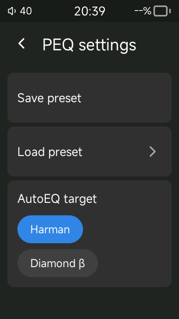
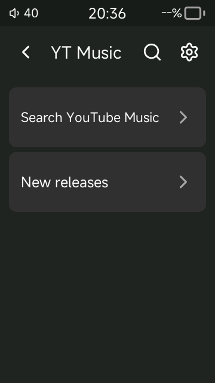
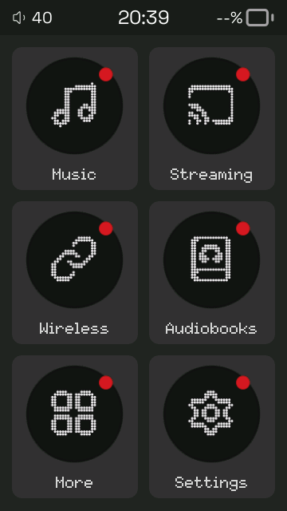
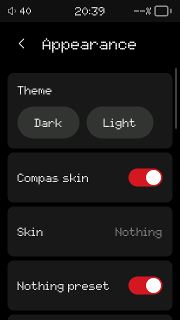

# Sonix Player for the Hidizs AP80 Pro Max

A fork of [Sonix Player](https://github.com/Tartarus6/sonix-player) that runs on the
**Hidizs AP80 Pro Max** as a **third player**, next to the original HiBy OS and
[Rockbox](https://www.rockbox.org). You pick which one starts in the boot menu.

Sonix lives entirely on the **SD card**. The only thing that changes in the player
itself is the boot menu, which gets one more entry: **SONIX**.

[](https://buymeacoffee.com/Fos4)

> [!CAUTION]
> **Use at your own risk.** This is a hobby project. It has **not been thoroughly
> tested**, and only on one player. Installing it, and above all flashing the boot
> menu, can damage your player or leave it unable to start. The author gives
> **no warranty** and is **not responsible for any damage** to your device, your
> data or anything else. If you are not comfortable with that, do not install it.

> **This repository contains source code, patches and scripts only**, no firmware.
> Ready-made files (the SD card package and a pre-patched firmware update file, the
> same kind Rockbox offers) are on the
> [Releases](https://github.com/Fos4ity/sonix-ap80/releases) page. You can also
> build everything yourself, see below.

| Home | Rockbox DSP | PEQdB target | YouTube Music |
|:---:|:---:|:---:|:---:|
|  |  |  |  |

| Nothing skin | Nothing Light skin | Icon packs and fonts | Appearance |
|:---:|:---:|:---:|:---:|
|  |  |  |  |

Screenshots come from the PC simulator at the AP80's resolution (360x640).

## What this fork adds

Everything Sonix already does is described in [FEATURES.md](FEATURES.md) and in the
original [README](README.sonix.md). On top of that:

- **Hidizs AP80 Pro Max support.** The 360x640 screen, and running from the SD card
  instead of from the firmware.
- **SONIX entry in the boot menu.** Rockbox, Tools, HiBy Player, Sonix.
- **Rockbox DSP.** Rockbox's sound effects inside Sonix: perceptual bass enhancement
  (PBE), bass and treble, auditory fatigue reduction and Haas surround.
  *Music > gear icon > Rockbox DSP.*
- **PEQdB target for AutoEq.** Downloaded headphone corrections can be re-targeted
  from Harman to the [PEQdB](https://peqdb.com/) "Diamond β" curve. *PEQ > gear icon > AutoEQ target.*
- **Skins.** Colour skins in the simple `.theme` format used by
  [Compas player](https://github.com/Starnished66/compas-player), with an
  optional accent colour. Two are included: Nothing and Nothing Light.
- **Fonts and icon packs.** 13 fonts and 6 icon packs to choose from, with previews.
- **YouTube Music.** Search, albums, artists, playlists and playback. Signing in
  (likes, your playlists) is optional.
- **Small fixes for the narrow screen**: scrolling labels, Flappy Bird, the top bar.

## How it works

```
power on
   └── boot menu (Rockbox bootloader + our patch)
         ├── ROCKBOX       Rockbox, from the SD card
         ├── TOOLS         Rockbox's tools screen
         ├── HIBY PLAYER   the original firmware
         └── SONIX         runs sonix.sh from the SD card  ← added by this fork
```

`sonix.sh` starts `sonix/sonix_player` from the card. Remove the card, or delete
the `sonix` folder, and the player is exactly as it was before.

## Quick install (from the release)

No PC tools needed, only a card reader.

1. Download `sonix-ap80-sdcard.zip` from
   [Releases](https://github.com/Fos4ity/sonix-ap80/releases) and unzip it to the
   **root of the SD card**. You get `sonix.sh`, a `sonix` folder and a `.rockbox` folder.
2. **If you already run Rockbox** on the player: choose
   **TOOLS > Run script > sonix.sh** in the boot menu. Done, nothing was flashed.
3. **If you want SONIX in the boot menu**, or you do not have Rockbox at all: download
   `ap80max-v12-sonix-patched.upt`, put it in the root of the SD card renamed to
   `ap80max.upt`, and in HiBy OS go to
   *System Settings > Firmware Update > via SD Card > Update System Firmware > OK*.
   After the restart pick SONIX. Then delete `ap80max.upt` from the card.

Step 3 flashes the player. Read the warning at the top first.

### What has to be on the SD card

| Boot menu entry | Needs on the card | If it is missing |
|---|---|---|
| HIBY PLAYER | nothing | always works |
| TOOLS | nothing | always works |
| SONIX | `sonix.sh` and the `sonix` folder | "sonix.sh not found on SD", back to the menu |
| ROCKBOX | the `.rockbox` folder from a [Rockbox build](https://www.rockbox.org/wiki/HidizsPort) | "Cannot boot Rockbox!", back to the menu |

You do **not** need Rockbox to use Sonix. Without it the player is not harmed and
does not hang: a missing player shows a short message and the menu comes back, so
you can always pick HIBY PLAYER.

The menu remembers your last choice in the `.rockbox` folder on the card. That is
why the SD card package contains an (almost) empty one. Without that folder, or
without a card, the menu starts at ROCKBOX every time and waits for you to choose.

## Build it yourself

You need a Linux PC (or WSL on Windows) to build. Allow an hour or two the first
time, most of it is the compiler building itself.

**0. Install Rockbox first.** Follow the official
[Rockbox guide for the AP80 Pro Max](https://www.rockbox.org/wiki/HidizsPort). After
this you already have a boot menu with ROCKBOX, TOOLS and HIBY PLAYER.

**1. Build Sonix.**

```
git clone https://github.com/Fos4ity/sonix-ap80.git
cd sonix-ap80/sonix-player
make -j8 target
```

**2. Put it on the SD card.**

```
cd ..
./ap80/make_sdcard.sh
```

Copy the *contents* of `ap80/out/` to the root of the SD card. You get `sonix.sh`
and a `sonix` folder there.

**3. Try it, without flashing anything.** In the boot menu choose
**TOOLS > Run script > sonix.sh**. Sonix starts. If this is enough for you, stop here.

**4. Optional: add SONIX to the boot menu.** This is the only step that writes to the
player's firmware. Read [ap80/BUILD.md](ap80/BUILD.md), it is short:

```
# build the boot menu from Rockbox + our patch   -> bootloader.ap80max
# then put it into YOUR firmware file:
./ap80/make_upt.sh ap80max.upt bootloader.ap80max
```

Put the resulting file on the SD card as `ap80max.upt` and install it in HiBy OS:
*System Settings > Firmware Update > via SD Card*.

### Going back

Install the original firmware from [Hidizs](https://www.hidizs.net) the same way,
then delete `sonix.sh` and the `sonix` folder from the card.

### Warning

Flashing firmware can leave a player that does not start. Keep the original
`ap80max.upt` somewhere safe before you begin. Step 3 needs no flashing at all.

Everything here is provided **as is, with no warranty**, as the GPL says. It was
not thoroughly tested. The author is not responsible for any damage. You install
it at your own risk.

## What is in this repository

| Where | What |
|---|---|
| `sonix-player/` | Sonix Player source with the AP80 changes (one commit per feature on the `ap80` branch) |
| `ap80/bootloader/` | Patch for the Rockbox boot menu, and a script to try a build without flashing |
| `ap80/make_upt.sh` | Puts the boot menu into a firmware file you supply |
| `ap80/make_sdcard.sh` | Collects everything that goes on the SD card |
| `ap80/sdcard/` | `sonix.sh` and the extra resources: fonts, icon packs, skins |
| `ap80/tools/` | Scripts that generated the Nothing icon tiles and the Doto font variant |
| `ap80/musicbee/` | Optional MusicBee add-on: send tracks to the player over Wi-Fi |
| `ap80/BUILD.md` | Build details |

Want the changes as plain patches against upstream Sonix?
`git format-patch 5d8bb174..ap80 -- sonix-player` gives you one file per feature.

## Credits: what we borrowed and from whom

This fork stands on other people's work. Thank you.

| What | From | Author(s) | Licence |
|---|---|---|---|
| The player itself | [Sonix Player](https://github.com/Tartarus6/sonix-player) | Tartarus6, started by Jepl4r / M4ttia | GPL v3 |
| Boot menu | Rockbox, [`bootloader/hibyos_linux.c`](https://github.com/Rockbox/rockbox/blob/master/bootloader/hibyos_linux.c) | Amaury Pouly, Marcin Bukat, Roman Stolyarov, Solomon Peachy | GPL v2 or later |
| AP80 Pro Max port of Rockbox | [Rockbox HidizsPort](https://www.rockbox.org/wiki/HidizsPort) | the Rockbox team | GPL v2 or later |
| Firmware repacking script | Rockbox, [`tools/r1_patcher/r1_patcher.sh`](https://github.com/Rockbox/rockbox/blob/master/tools/r1_patcher/r1_patcher.sh) | the Rockbox team | GPL v2 or later |
| Bass enhancement (PBE) | Rockbox, [`lib/rbcodec/dsp/pbe.c`](https://github.com/Rockbox/rockbox/blob/master/lib/rbcodec/dsp/pbe.c) | Chiwen Chang | GPL v2 or later |
| Auditory fatigue reduction | Rockbox, [`lib/rbcodec/dsp/afr.c`](https://github.com/Rockbox/rockbox/blob/master/lib/rbcodec/dsp/afr.c) | Chiwen Chang | GPL v2 or later |
| Haas surround | Rockbox, [`lib/rbcodec/dsp/surround.c`](https://github.com/Rockbox/rockbox/blob/master/lib/rbcodec/dsp/surround.c) | Chiwen Chang | GPL v2 or later |
| Bass / treble | Rockbox, [`lib/rbcodec/dsp/tone_controls.c`](https://github.com/Rockbox/rockbox/blob/master/lib/rbcodec/dsp/tone_controls.c) | Thom Johansen, Michael Sevakis | GPL v2 or later |
| Compiler toolchain | Rockbox, `rockboxdev.sh` (already used by Sonix) | the Rockbox team | GPL v2 or later |
| "Diamond β" target curve | [PEQdB](https://peqdb.com/) | sharur (S. Chala, *An Optimized Headphone Target Response Curve*) | curve values only |
| Headphone corrections | [AutoEq](https://github.com/jaakkopasanen/AutoEq) (already used by Sonix) | Jaakko Pasanen | MIT |
| Skin file format | [Compas player](https://github.com/Starnished66/compas-player) | Starnished66 and the Compas contributors | GPL v3 (format only, no code taken) |
| Icons | [Lucide](https://lucide.dev), [Phosphor](https://phosphoricons.com) | their contributors | ISC, MIT |
| Fonts | Inter, Lexend, Nunito, Noto Sans, Source Sans 3, Atkinson Hyperlegible, Comfortaa, JetBrains Mono, Merriweather, Oswald, Quicksand, Space Grotesk, Doto | their designers | SIL OFL 1.1 (licence file next to each font) |

The Rockbox effects were rewritten from fixed point to floating point to fit Sonix's
audio path; the original copyright notices are kept in
[`sonix-player/src/system/audio/pbe.c`](sonix-player/src/system/audio/pbe.c).

Not affiliated with Hidizs, HiBy, Rockbox, Google, Nothing or the Sonix authors.
All product names belong to their owners.

## Support

If this port is useful to you, you can
[buy me a coffee](https://buymeacoffee.com/Fos4). It is entirely optional.

The player itself is the work of the Sonix authors. If you like Sonix, please
support them too: [Ko-fi of the original author](https://ko-fi.com/m4ttia59438),
and see the [upstream project](https://github.com/Tartarus6/sonix-player).

## Licence

GPL v3, the same as Sonix Player, see [LICENSE](LICENSE). The parts taken from
Rockbox are GPL v2 *or later*, which allows using them under v3. The boot menu
patch and `ap80/make_upt.sh` stay GPL v2 or later, like the Rockbox files they change.
